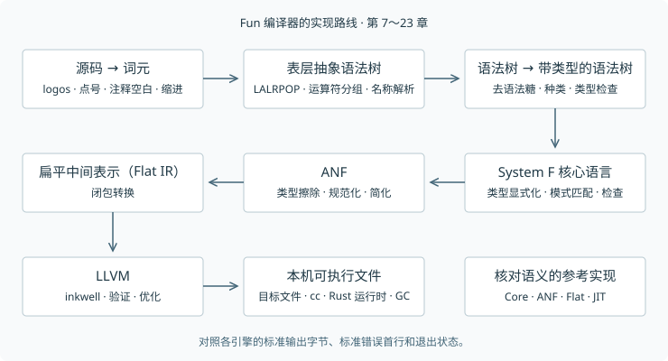

# 第 1 章　导读

[中文目录](../README.md) · [英文原章](https://sdiehl.github.io/write-you-a-haskell/ch01-introduction.html) · [配套源码](https://github.com/sdiehl/write-you-a-haskell/tree/51c70f804173c9d013187c543a353686b413ad50)

## 为什么写这本书

2014 年，我开始写这本书，因为当时我想读的那本入门书找不到。讲函数式语言编译器的材料，有的开篇就把人淹没在细节里，有的写给做研究的人，和我这样想做出软件的人隔着一层。我最想要的是有人带我拆开一台真正能跑的编译器。走到哪一步、碰上什么问题，就在那儿把用得着的道理讲明白。

后来我一点点补上了这些知识。但后面的人何必再绕一遍同样的远路？我索性把当年想读的书写出来，给下一个爬到这里的人搭个梯子。

我们要做的语言叫 Fun。它是一门严格求值的函数式语言，支持类型推断、代数数据类型、按名称区分类型的记录（nominal records），还有类型类。我们用 Rust 写编译器，一直做到让 LLVM 生成机器能直接运行的本机代码。中间还会写几个解释器，这样即使代码生成器还没动工，写好的程序也能运行。它们也能帮我们逐步核对，每次改写程序有没有改掉它的意思。Fun 的语法和类型规则从《Haskell 2010 语言报告》起步。[^haskell2010]

理解编译器时，不妨把每一步的输入和输出都看成一门小语言，想清楚这一步到底把什么变成了什么。前几章把解析、求值、类型推断拆开学。从第 7 章起，每一章的 Rust 包（crate）都保存着同一个编译器在那个阶段的完整版本。读一章时，把它和上一章的代码差异放在一起看。某个功能越看越糊涂，就退回到它还没加进去的版本，跑个例子再回来。

## 搭建环境

书中的代码支持 Apple Silicon 上的 macOS，以及 x86-64 或 AArch64 上的 Linux。Rust 和 Cargo 负责编译各章代码，`just` 负责运行仓库里预先写好的命令。运行时需要 C 编译器和 Boehm 垃圾回收器，生成本机代码和即时编译（JIT）需要 LLVM 22。把书排成 HTML 或 PDF 另有一套工具，用 `just bootstrap` 安装。

### macOS

先安装 Apple 命令行开发工具。如果机器上还没有 `brew`，按 [Homebrew 的安装说明](https://brew.sh/) 装好，再安装系统依赖。

```sh
xcode-select --install
brew install git python just llvm@22 bdw-gc pkg-config
export LLVM_SYS_221_PREFIX="$(brew --prefix llvm@22)"
export GC_LIB_DIR="$(brew --prefix bdw-gc)/lib"
```

等命令行工具装完再开始构建。如果以后新开的终端也要用，把两行 `export` 写进 shell 配置。这里特意写了 `llvm@22`。如果让包管理器自己挑版本，装到的 LLVM 可能和 Rust 绑定所要求的二进制接口（ABI）不兼容。

### Ubuntu

下面的命令面向本版写作时的 Ubuntu 26.04 LTS，也适用于上游持续集成使用的 Ubuntu 24.04 环境。先装通用工具，再用 [LLVM 官方安装脚本](https://apt.llvm.org/) 明确选择第 22 版。

```sh
sudo apt update
sudo apt install -y build-essential git curl wget ca-certificates \
  gnupg lsb-release software-properties-common python3 pkg-config \
  libgc-dev libssl-dev just
curl -fsSLo /tmp/wyah-llvm.sh https://apt.llvm.org/llvm.sh
sudo bash /tmp/wyah-llvm.sh 22
sudo apt install -y llvm-22-dev libpolly-22-dev
export LLVM_SYS_221_PREFIX=/usr/lib/llvm-22
```

同样，把 LLVM 的安装路径写进 shell 配置，后面编译时还会用到。发行版自带的 Rust 版本未必跟本书一致，下一步用 rustup 安装。

### 安装 Rust，打开配套代码仓库

按 [Rust 官方安装指南](https://rust-lang.org/tools/install/) 安装工具链，再克隆配套源码。后面各章的 `cargo` 和 `just` 命令都在这份**英文原书的代码仓库**里执行。中文仓库用来对照阅读。

```sh
curl --proto '=https' --tlsv1.2 -sSf https://sh.rustup.rs | sh
. "$HOME/.cargo/env"
git clone https://github.com/sdiehl/write-you-a-haskell.git
cd write-you-a-haskell
rustup show
rustc --version
cargo --version
```

进入目录后，rustup 会读到 `rust-toolchain.toml`，按需安装这里指定的 Rust 1.99.0、Clippy 和 rustfmt。项目怎样给自己选工具链，可以看 [rustup 手册](https://rust-lang.github.io/rustup/overrides.html#the-toolchain-file)。`just` 帮我们给常用命令起名字，构建工作仍然由 Cargo 等工具完成。也可以用 [just 安装指南](https://just.systems/man/en/packages.html) 里列的其他方式安装。

先跑起第 2 章的小计算器（输入 `:quit` 退出），再构建整个工作区，检查格式和 Clippy 警告。

```sh
cargo run -p ch02_calc -- repl
just build
cargo fmt --all -- --check
cargo clippy --workspace --all-targets -- -D warnings
```

如果要在本机生成原书的 HTML 和 PDF，再安装它固定版本的排版工具。

```sh
just bootstrap
just book
just pdf
```

第一条命令会把 mdBook 及其预处理器、Pandoc、Typst 装到仓库的 `.tools` 目录中。`just` 运行任务时会把 `.tools/bin` 放进 `PATH`，字体已经随仓库提供。生成后打开 `book/build/html/index.html` 或 `build/write-you-a-haskell.pdf` 即可。线上也能读 [HTML 原书](https://sdiehl.github.io/write-you-a-haskell/) 或[下载 PDF](https://sdiehl.github.io/write-you-a-haskell/write-you-a-haskell.pdf)，同一份 PDF 还随上游最新的 GitHub Release 发布。用 `cargo test --workspace` 跑编译器的整套测试，其中包括深递归和内存分配的回归用例。

### 用 Nix 准备环境

如果已经[安装 Nix](https://nixos.org/download/)，在上游代码仓库里进入 flake 的开发环境即可。它给 Apple Silicon macOS 和上述两种 Linux 架构提供指定版本的 Rust、LLVM 22、Boehm、C 编译器和开发工具。

```sh
nix --extra-experimental-features 'nix-command flakes' develop
just build
just bootstrap
just pdf
```

锁文件固定了依赖的版本。开发 shell 会设置 LLVM 和垃圾回收库的路径，可以省掉前面按操作系统安装依赖的步骤。排版工具仍由 bootstrap 按书中指定的版本装进 `.tools`。

## 为什么这一版用 Rust

我在 2010 年代中期写初版时，Haskell 很适合用来讲编译器。代数数据类型、模式匹配加上简洁的语法，能让一段改写语法树的代码看起来跟数学定义相差无几。可一旦要从这些定义走到能生成本机代码的完整编译器，就得依赖一些维护力量单薄的库。按我这些年的经验，这个问题变得更明显了。

我现在仍然喜欢 Haskell 写出来的样子。但动手维护这个编译器时，我还得关心 LLVM 绑定有没有人维护、诊断与打包工具是否好用、测试是否方便，以及运行时行为能否预估。隐式惰性求值还会把源码和实际开销隔开一层。看着一行代码，很难立刻知道它会在什么时候计算，又会在哪里分配内存。编译器要稳定地处理大输入时，这些问题都绕不过去。

我为这一版选 Rust，看重的是它的生态规模，以及生产工具一直有人投入。用枚举和模式匹配，照样能把中间语言写得很清楚。所有权让数据由谁持有一目了然，也方便我们直接接触 LLVM 和本机运行时。每章一个快照，Cargo 能把它们放在一起构建、测试。我希望读者把时间花在学编译上，而且读完全书，还有一套愿意接着用的工具。

对我手上的这个项目来说，Rust 兼顾了表达力和落地的便利。以后也许会有 OCaml 版。Haskell 依然值得研究，而这一版我想用 Rust 来做。最初的 Haskell 实现保存在上游的 [`haskell-edition` 标签](https://github.com/sdiehl/write-you-a-haskell/tree/haskell-edition)下。

## Fun 为什么选严格求值

代数数据类型、模式匹配、主类型（能概括其余合法类型的最一般类型）、纯函数和类型类，都是 Haskell 教给我们的好东西。Fun 保留这些，同时采用**按值调用**（call-by-value）。调用函数之前先算好实参，构造一个值之前先算好各个字段，普通 `let` 绑定先算出右边的值再进入主体。这样，读代码就比较容易看出工作何时发生、哪里需要存东西。

我不倾向于让新语言默认对所有计算都延迟求值。比如一个绑定在源码里看着已经用完了，一段还没算的表达式却可能一直留着它当时的环境。等到很远的地方有人索取结果，计算才发生，错误也可能在那里才冒出来。共享计算的结果可以省掉重复工作，却要额外安排空间、规定何时把结果写回去。严格性分析能在不少情况下挽回性能，但也得搭起相当复杂的机制，才能还原本可直接说清的成本。第 5 章会让不同策略跑同样的例子，把这种取舍摆在眼前。

有些工作确实值得推迟。如果要让程序显式选择哪里推迟，我喜欢 **call-by-push-value（CBPV）** 这套基础。它把“值”和“计算”分开。一次计算可以产生一个值，一个值也可以装着一段尚未执行的计算。用 `thunk` 把计算挂起来，用 `force` 要求它开工。用这几个更小的动作，既能描述按值调用，也能描述按名调用。决定在哪儿延迟的可以是程序员，也可以是编译器。[^levy2001]

把计算挂起来和把结果记下来，是两件事。一个普通 thunk 被强制求值两次，里面的工作就可能做两遍。要做到**按需调用**（call-by-need），还要让用到同一份实参的地方共享一处存储，第一次算完把结果写回。正因为能把这两件事分开讲，我才喜欢用 CBPV 来研究惰性。本书实现的 Fun 始终是严格按值调用的语言，CBPV 和显式惰性值留给以后的语言设计。

## 全书路线图

第 2～6 章各做一门独立的小语言。从第 7 章到第 24 章，我们才是在同一个 Fun 编译器上逐步加功能。下面每一行写的都是读完那章能做出什么。第一、二部分的章节链接打开中文译文，第三部分的链接打开英文原书。

### 第一部分　基础

| 章 | 主题 | 动手实现 |
| ---: | --- | --- |
| 1 | [导读](ch01-introduction.md) | 配好工作区、测试运行器、分章工具，以及 HTML 和 PDF 的生成流程。 |
| 2 | [语法分析](ch02-parsing.md) | 用 logos 和 LALRPOP 做一门算术语言，再写一个 Pratt 解析器作对照，配上错误诊断和交互式命令行。 |
| 3 | [λ 演算](ch03-lambda.md) | 实现替换、de Bruijn 索引、正规序归约，还有严格求值的闭包。 |
| 4 | [简单类型 λ 演算](ch04-stlc.md) | 给函数参数加类型标注，在求值前先做类型检查。 |
| 5 | [求值](ch05-evaluation.md) | 支持递归函数，用 CEK 机把宿主语言的调用栈保持在常数深度，再与按名调用对照。 |
| 6 | [Hindley–Milner 类型推断](ch06-hindley-milner.md) | 给 `let` 绑定推断多态类型，分别用算法 W 和带层级的并查集实现。 |

### 第二部分　前端

| 章 | 主题 | 动手实现 |
| ---: | --- | --- |
| 7 | [设计 Fun](../part-2/ch07-fun.md) | 做出第一个 Fun 编译器，记录源码区间、给出错误诊断、管理编译阶段，并提供 Core 中间语言和命令行。 |
| 8 | [缩进布局和扩展语法](../part-2/ch08-layout.md) | 按缩进划分代码块，在格式化时保留注释，支持类型签名、运算符优先级与结合性，以及只给运算符一个操作数的写法（section）。 |
| 9 | [名称解析](../part-2/ch09-renamer.md) | 为绑定分配唯一名称，理清词法作用域，把依赖分组并处理相互递归。 |
| 10 | [带类型的 Core 与 Core Lint](../part-2/ch10-typed-core.md) | 把程序转成显式带类型的 System F，再独立检查一遍，揪出编译器自己的错误。 |
| 11 | [数据类型与模式匹配](../part-2/ch11-datatypes.md) | 支持代数数据类型、列表、元组、嵌套模式、函数的多条定义方程和守卫。 |
| 12 | [记录](../part-2/ch12-records.md) | 按类型名称区分记录，支持构造、更新、模式匹配，并解析用点号访问的字段。 |
| 13 | [种类与类型构造器](../part-2/ch13-kinds.md) | 支持高阶类型构造器，推断种类（kind），检查类型别名。 |
| 14 | [类型类](../part-2/ch14-type-classes.md) | 处理约束、实例、超类、默认规则、字典传递和 `Double`。 |
| 15 | [Monad、do 记法与 IO](../part-2/ch15-io.md) | 实现抽象高阶类型构造器的控制类、`do` 记法和隐藏内部表示的 `IO`，运行带副作用的程序。 |
| 16 | [编译模式匹配](../part-2/ch16-pattern-compilation.md) | 把模式编译成决策树和汇合点，报告遗漏或多余的分支。 |
| 17 | [Prelude 与自动派生](../part-2/ch17-prelude.md) | 用 Fun 自己写好 Prelude，并自动生成 `Eq`、`Ord` 和 `Show` 实例。 |

### 第三部分　后端

| 章 | 主题 | 动手实现 |
| ---: | --- | --- |
| 18 | [A-正规形与汇合点](https://sdiehl.github.io/write-you-a-haskell/ch18-anf.html) | 擦除类型，转换到 A-正规形（ANF），写一个小型简化器和一个能迭代执行的参考解释器。 |
| 19 | [闭包转换](https://sdiehl.github.io/write-you-a-haskell/ch19-closures.html) | 显式记录闭包环境，提升函数，支持部分应用，并为 Flat IR 编写参考解释器。 |
| 20 | [数据表示与运行时](https://sdiehl.github.io/write-you-a-haskell/ch20-runtime.html) | 实现带标签的机器字、堆对象布局、eval/apply 协议与共用的原语，并用 Boehm 管理运行时的垃圾回收。 |
| 21 | [LLVM 代码生成](https://sdiehl.github.io/write-you-a-haskell/ch21-llvm.html) | 生成本机目标文件，完成链接和尾调用，再跟解释器对照测试。 |
| 22 | [JIT 与交互式命令行](https://sdiehl.github.io/write-you-a-haskell/ch22-jit.html) | 通过 LLVM 即时执行代码，做一个能保留会话状态、查看类型、种类与各阶段输出的 REPL。 |
| 23 | [优化](https://sdiehl.github.io/write-you-a-haskell/ch23-optimization.html) | 优化时避免重复原有工作，分析哪些全局定义可达，并用本机表示保存数值中间结果。 |
| 24 | [精确垃圾回收（选读）](https://sdiehl.github.io/write-you-a-haskell/ch24-garbage-collection.html) | 追踪仍然存活的根，维护影子栈，做一个经压力测试的复制式回收器。 |
| 25 | [后续方向](https://sdiehl.github.io/write-you-a-haskell/ch25-future-work.html) | 探索怎样扩展惰性求值、模块、更丰富的类型系统、优化和调试。 |

附录集中列出文法、类型规则、中间表示、运行时 ABI 和诊断索引，书末另有参考文献。

## 我们怎样一步步把它做出来

我们从计算器起步。敲进去一串字符，屏幕上怎么就出现了一个数？计算器足够小，整个过程你都能跟下来。接下来每门小语言各自聚焦一个问题，比如函数怎么表示、表达式怎么求值、类型怎么检查。每门都有一份完整的 Rust 实现，可以运行，也可以改。掌握整个编译器之前，你就能先拿其中一块做实验。

到了第 7 章，这些想法才汇入 Fun。此后每章从上一章的编译器出发，只添一块。比如，记录给语言增加新的数据形式，类型类让不同类型共用一套操作，后面的章节再让编译器生成本机代码。每章都有自己的 crate，因此新旧两版可以并排打开。

除了读成品，还要读改动。每章开头会列出新增和修改过的文件，最值得看的排在前面。对照两个快照，就知道“加一个语言特性”究竟意味着什么。你能看到它是否需要一种新的语法树节点、一条新的类型规则，以及怎样把它翻译成已有的简单操作。书里的代码片段直接取自对应源码，读到和跑到的是同一份实现。前面章节的测试也会保留下来，帮助我们发现新增功能是否弄坏了旧功能。

理论跟着问题走。先试一个小例子，看看它提出了什么问题，再引入刚好够用的记号，把答案说准确。如果一条规则初看难懂，先跑代码，看到它在做什么，再回来读。你不需要先修过类型论。熟悉 Rust 的枚举、模式匹配、借用和 Cargo，会更容易跟上实现。

## 改了写法，怎样保住原意？

计算机能运行一段程序之前，编译器会把它改写好几遍。难处在于，每一步都可以换个写法，但程序做的事必须保得住。源码打印 `42`，最终的机器码也得打印 `42`。源码先问你的名字，再跟你打招呼，编译后这两件事的顺序也得一样。

第一步是认出源码各部分怎么组合。`1 + 2 * 3` 里，乘法整体是加法的右操作数。接着要检查这些操作有没有意义，比如在运行前就指出“把一个数和一个函数相加”有问题。再往后，逐步把程序改写成更简单、更容易生成机器码的形式。

怎样发现某一步翻错了？一个实用办法是给每种中间形式写个小解释器，让同一个例子在改写前后各跑一次。结果不同，就抓到了一个编译器错误。结果相同还称不上对所有程序的证明，却能让我们每走一步都有东西可核对。我们也会学习怎样用类型和求值规则推理，把视野扩展到测试样例之外。[^pierce2002]



## 把仓库和书一起读

每章的代码都可以实际运行、拆开、修改。如果好奇某个阶段到底改了哪里，就让编译器把该阶段的输出打印出来，对着输入看。这比盯着实现猜它做了什么，往往更容易看懂。

随着功能增加，我们还得确信原来的例子照样能跑。`testkit` 会运行小程序，核对输出、错误信息和退出状态。后面它还会让同一个程序换几种执行引擎来跑。一旦结果不一致，就有了值得追下去的具体线索。

```rust
/// The chapter supplies its binary and available engines; the runner owns policy.
pub struct Config<'a> {
    pub binary: &'a Path,
    pub programs: &'a Path,
    pub engines: &'a [Engine],
    pub timeout: Duration,
}
```

[源码 · lib.rs 第 38～44 行](https://github.com/sdiehl/write-you-a-haskell/blob/51c70f804173c9d013187c543a353686b413ad50/testkit/src/lib.rs#L38-L44)

`xtask` 负责一些重复劳动，比如复制一章的代码，再检查从上一章带过来的例子。书中的 Rust 片段直接取自相应的 crate，顺着函数名就能找到源码，动手做实验。原书的 HTML 和 PDF 也出自同一套章节文件。

## 跑起来

在原书仓库中用 `just bootstrap` 装好指定版本的排版工具，再运行下面三条命令。

```text
$ cargo test --workspace
$ just book
$ just pdf
```

HTML 输出在 `book/build/html/`，PDF 在 `build/write-you-a-haskell.pdf`。第 2 章起就能查看编译中间结果，例如用 `dump --pass=parse` 查看解析得到的树。第 1 章先把环境准备好。

## 延伸阅读

要查 Haskell 本身的定义，可以读《Haskell 2010 语言报告》。[^haskell2010] 想看本书会用到的求值判断和类型判断，读 Pierce 的《Types and Programming Languages》。[^pierce2002] Kiselyov 把类型泛化和依赖跟踪联系起来，读到第 6 章时很有帮助。[^kiselyov2013] 如果想把本书的设计和真正的 GHC 对照，Takenobu Tani 的《GHC Reading Guide》画出了 GHC 的源码结构和编译流程。[PDF](https://takenobu-hs.github.io/downloads/haskell_ghc_reading_guide.pdf) · [GitHub](https://github.com/takenobu-hs/haskell-ghc-reading-guide)

[^haskell2010]: Simon Marlow 主编（2010）。[Haskell 2010 Language Report](https://www.haskell.org/onlinereport/haskell2010/)。
[^levy2001]: Paul Blain Levy（2001）。[Call-by-Push-Value](https://pblevy.github.io/papers/thesisqmwphd.pdf)。
[^pierce2002]: Benjamin C. Pierce（2002）。[Types and Programming Languages](https://www.cis.upenn.edu/~bcpierce/tapl/)。
[^kiselyov2013]: Oleg Kiselyov（2013）。[How OCaml Type Checker Works—or What Polymorphism and Garbage Collection Have in Common](https://okmij.org/ftp/ML/generalization.html)。

---

[中文目录](../README.md) · [第 2 章　语法分析 →](ch02-parsing.md)
